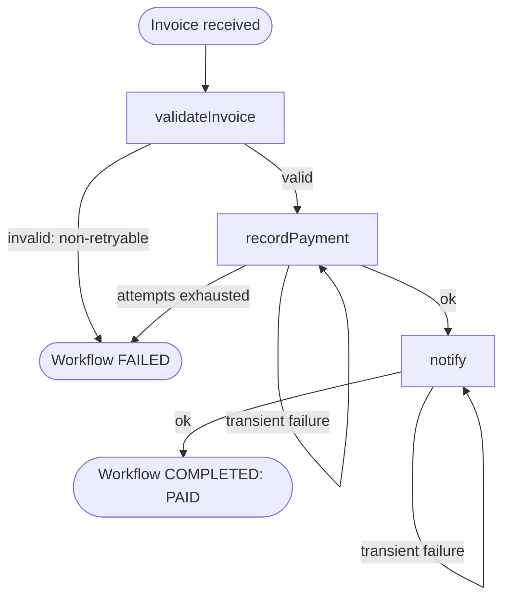

# Session 2 — The real process: invoices with retries

## Part 0 — Move into the dev container (10 min)

From this session on, development happens inside a Linux container: the same kind of
environment the code will run in on AWS.

Requirements: VS Code with the **Dev Containers** extension, and Docker Desktop running.

1. Open the `business-auto` folder in VS Code.
2. Command Palette (`Ctrl+Shift+P`) → **Dev Containers: Reopen in Container**.
3. Wait for the first build. It ends by running `npm install` inside the container.
4. Open a terminal in VS Code. The prompt should show `node ➜ /workspaces/business-auto`.

What changed:

| | On Windows (session 1) | In the dev container |
| --- | --- | --- |
| Temporal address used by your code | `localhost:7233` | `temporal:7233` (set through `TEMPORAL_ADDRESS`) |
| Temporal Web UI in your browser | http://localhost:8233 | http://localhost:8233 (unchanged) |
| Starting Temporal and Redis | `npm run infra:up` | Automatic: VS Code starts them with the container |
| `node_modules` | Windows folder | Docker volume (Linux binaries) |

Inside the container, `npm run infra:up` does not work and is not needed: there is no Docker
in there. Containers on the same Compose network reach each other by **service name**, which
is why the address becomes `temporal:7233`.

## The process



Human approval sits between validation and payment. It arrives in session 3.

## Concepts

### Two kinds of failure

| Kind | Example | Right reaction | In code |
| --- | --- | --- | --- |
| **Transient** | Payment API timed out, network blip | Try again later | Throw any normal `Error` |
| **Permanent** | Negative amount, unknown currency | Stop now; retrying cannot help | `ApplicationFailure.create({ nonRetryable: true })` |

In .NET terms this is the Polly distinction between exceptions you retry and exceptions you
do not. The difference is where the retry state lives: Polly keeps it in the memory of your
process, Temporal keeps it on the server. A retry survives a deployment or a crash.

### Retry policy (`src/workflows/invoice-approval.js`)

| Option | Value here | Meaning |
| --- | --- | --- |
| `initialInterval` | 1 second | Wait before the second attempt |
| `backoffCoefficient` | 2 | Each wait is double the previous one: 1s, 2s, 4s, 8s |
| `maximumInterval` | 10 seconds | Ceiling for that wait |
| `maximumAttempts` | 5 | After the fifth failure, the activity fails for good |

If you omit the policy, Temporal still retries: unlimited attempts with exponential backoff.

### Timeouts

`startToCloseTimeout` limits **one attempt**. It is how Temporal detects a worker that died
in the middle of an activity: no result within the timeout means the attempt failed, and the
retry policy takes over. Always set it.

### Idempotency

An activity can run more than once even when it "worked": the payment goes through, the worker
crashes before reporting success, and Temporal retries. So every activity with a side effect
needs a way to make the repeat harmless. `recordPayment` derives the payment ID from the invoice
ID (`pay-INV-...`), which a real payment system would use as an idempotency key.

## Steps

Use two terminals inside the dev container.

### 1. Happy path

```bash
npm run worker                 # terminal 1
npm run start:invoice          # terminal 2
```

Expected: `Result: { invoiceId: 'INV-...', status: 'PAID', paymentId: 'pay-INV-...' }`

### 2. Transient failures

```bash
npm run start:invoice -- flaky
```

`recordPayment` fails on attempts 1 and 2 and succeeds on attempt 3. Nothing in the workflow
code handles that; the retry policy does. Watch for:

- Worker log: two `Simulated transient failure` warnings, then `Payment recorded`.
- Total time: about 3 seconds (1s + 2s of backoff).
- Web UI → the workflow → Event History → the `recordPayment` activity: `Attempt 3`, and the
  last failure message is kept.

Note that the history holds **one** `ActivityTaskScheduled` for `recordPayment`, not three.
Retries happen inside a single scheduled activity and are not separate history events.

### 3. Retries exhausted

```bash
npm run start:invoice -- exhausted
```

Fails five times over about 15 seconds (1 + 2 + 4 + 8), then the workflow fails.
While it runs, open the workflow in the Web UI and look at **Pending Activities**: it shows
the current attempt, the last error and when the next attempt is due.

### 4. Permanent failure

```bash
npm run start:invoice -- invalid
```

Fails immediately, on attempt 1, with `Invalid invoice: amount must be a number greater than 0`.

### 5. Experiment: what if a permanent error were retryable?

1. In `src/activities/invoice.js`, change `nonRetryable: true` to `nonRetryable: false`.
2. Restart the worker (Ctrl+C, `npm run worker`). Workers do not reload code on their own.
3. `npm run start:invoice -- invalid`
4. It now takes about 15 seconds and five attempts to fail, with the same answer every time.
   With the default policy (unlimited attempts) it would retry forever.
5. Put `nonRetryable: true` back and restart the worker.

## Check yourself

- The payment provider answers HTTP 503. Retryable or not? And HTTP 400?
- Why is `maximumAttempts: 5` a business decision and not only a technical one?
- `recordPayment` succeeds but the worker dies before reporting it. What happens next, and
  what prevents a double payment?
- Why did you have to restart the worker in experiment 5 but not the Temporal server?

## Done when

- [ ] You are working inside the dev container.
- [ ] `flaky` completes on the third attempt with no intervention.
- [ ] `invalid` fails immediately; `exhausted` fails after five attempts.
- [ ] You can find the attempt count and last failure of an activity in the Web UI.
- [ ] Commit created: `Session 2: invoice approval workflow with retries`

## Troubleshooting

| Symptom | Cause and fix |
| --- | --- |
| Container build fails on port 7233, 8233 or 6379 | Something else is using the port. On Windows run `docker ps` and stop the other container |
| `Connection refused ... 127.0.0.1:7233` inside the container | `TEMPORAL_ADDRESS` is not set. Run `echo $TEMPORAL_ADDRESS`; if empty, rebuild the container |
| `Cannot find module` after reopening in the container | `npm install` did not finish. Run it again in the container terminal |
| Workflow stays Running with `Workflow type not found` in the worker log | The worker is running old code. Restart it |
| `Activity function ... is not registered on this Worker`, or scenarios take much longer than expected | A second worker with older code is polling the same task queue (for example, one left running on Windows). Check http://localhost:8233/namespaces/default/task-queues/business-processes, stop the stale process, and run again. The Web UI keeps listing a stopped worker for a few minutes |
| Web UI lost the session 1 workflows | Expected: the Temporal container was recreated and its history is in memory |
