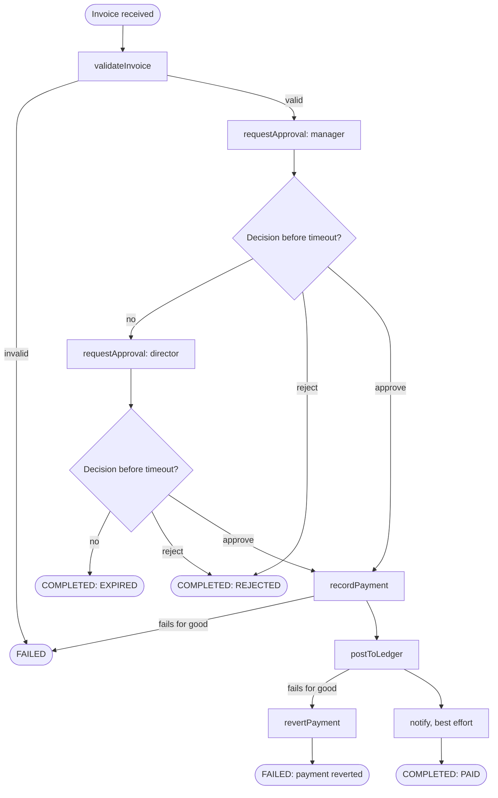

# Session 3 — Human wait: signals, queries, timers and compensation

Until now the process ran straight through. A real approval process spends most of its life
**waiting for a person**. This session adds that wait, a deadline for it, a way to ask the
process where it is, and a way to undo work when a late step fails.

## The process now



## Concepts

| Concept | What it is | In this project | .NET / Azure equivalent |
| --- | --- | --- | --- |
| **Signal** | An external event pushed into a running workflow. Stored in the history, so it cannot be lost | `approve`, `reject` | `RaiseEventAsync` + `WaitForExternalEvent` in Durable Functions |
| **Query** | A read-only question about current state. Not stored in the history | `status` | Custom status / entity read in Durable Functions |
| **`condition(fn, timeout)`** | Suspends the workflow until `fn` is true or the timeout passes | The approval wait | `Task.WhenAny(externalEvent, durableTimer)` |
| **Saga** | Each completed step registers how to undo itself; on failure the undo steps run in reverse | `recordPayment` ↔ `revertPayment` | Compensating transactions; Wolverine sagas |

### A waiting workflow costs nothing

While the workflow waits for approval there is no thread, no timer in your process and no row
you have to poll. It is a record on the Temporal server. A workflow can wait 30 seconds or 30
days and the code is the same line. That is why `approvalTimeoutSeconds` can stand in for what
would be days in production.

### Business outcome versus technical failure

| Ending | Workflow status | Why |
| --- | --- | --- |
| Paid | Completed, `status: PAID` | The process did its job |
| Rejected by a person | Completed, `status: REJECTED` | The process did its job; the answer was no |
| Nobody answered | Completed, `status: EXPIRED` | Same: a valid business outcome |
| Invalid invoice, or a system that never recovered | **Failed** | Something went wrong and someone should look |

Keeping these apart means "Failed" in the Web UI always deserves attention.

### Why notify does not trigger a compensation

Once the payment is recorded and booked, the business fact is true. Failing to send an e-mail
must not undo a payment, so `notify` is best effort: the result reports `notified: false` and
the workflow still completes as `PAID`. The ledger is different: money paid but never booked is
an inconsistent state, so that failure reverts the payment.

## Steps

Three terminals inside the dev container: one for the worker, one for commands, and the Web UI
open in the browser. **Restart the worker first**: the code changed.

```bash
npm run worker
```

Starting a workflow now returns immediately and prints the commands to use next. Copy the
workflow ID it prints (`invoice-INV-...`); the examples below call it `<id>`.

### 1. Approve

```bash
npm run start:invoice -- happy 120
npm run invoice -- status <id>      # status: AWAITING_APPROVAL
npm run invoice -- approve <id>
npm run invoice -- status <id>      # status: PAID, decision filled in
```

In the Event History, find `WorkflowExecutionSignaled`: the approval is part of the permanent
record, with who sent it.

### 2. Reject

```bash
npm run start:invoice -- happy 120
npm run invoice -- reject <id> "Duplicate invoice"
npm run invoice -- result <id>      # status: REJECTED
```

The workflow shows **Completed**, not Failed.

### 3. Escalation and expiry

```bash
npm run start:invoice -- happy 15
```

Do nothing and watch the worker log and the Web UI:

- After 15 s: `Approval requested ... level: director`, and the query reports `ESCALATED`.
- After 30 s: the workflow completes with `status: EXPIRED`.

Run it again and approve during the second window: it ends as `PAID` with `escalated: true`.

### 4. Experiment: approve while no worker is running

1. `npm run start:invoice -- happy 300`
2. Stop the worker (Ctrl+C).
3. `npm run invoice -- approve <id>` — it succeeds: the server stored the signal.
4. `npm run invoice -- status <id>` — it hangs and then fails. A query needs a worker to
   run the workflow code; a signal does not.
5. Start the worker. The workflow picks up the stored signal and finishes as `PAID`.

### 5. Compensation

```bash
npm run start:invoice -- compensate 120
npm run invoice -- approve <id>
```

In the worker log, in order: `Payment recorded`, five `postToLedger` failures over about 15
seconds, then `Payment reverted`. The workflow ends as **Failed**, and:

```bash
npm run invoice -- status <id>      # status: PAYMENT_REVERTED
```

Queries still work on a closed workflow, as long as a worker is running.

Compare with `npm run start:invoice -- exhausted 120` (approve it too): `recordPayment` never
succeeded, so there is nothing to revert and the status is `FAILED`.

### 6. Optional: the same from the Web UI and the Temporal CLI

Web UI: open a running workflow and use the **Send a Signal** action with signal name
`approve` and input `{"approver":"web-ui"}`.

Temporal CLI, if `temporal --version` works in the container:

```bash
temporal workflow signal --workflow-id <id> --name approve --input '{"approver":"cli"}'
temporal workflow query  --workflow-id <id> --type status
```

## Check yourself

- A signal arrives while the workflow is still validating the invoice. Is it lost? Why not?
- Why must a query handler never change workflow state?
- Why does `revertPayment` have no `maximumAttempts` while the other activities have five?
- Two managers approve and reject at almost the same time. What decides the outcome?
- You change `approvalTimeoutSeconds` from seconds to 5 days. What changes in the code and in
  the infrastructure?

## Done when

- [ ] You approved, rejected and let an invoice expire, and each ended in the expected status.
- [ ] You saw the escalation happen after the first timeout.
- [ ] `compensate` ended as Failed with status `PAYMENT_REVERTED`.
- [ ] Experiment 4 worked: a signal sent with no worker running was not lost.
- [ ] Commit created: `Session 3: human approval, escalation and compensation`

## Troubleshooting

| Symptom | Cause and fix |
| --- | --- |
| `status` or `approve` says the workflow was not found | Wrong ID. Use the full ID printed by `start:invoice`, including the `invoice-` prefix |
| `status` hangs | No worker is running, or it is running old code. Restart `npm run worker` |
| Signal accepted but nothing happens | The workflow already had a decision or had already ended. Check `status` |
| Workflow started before this session's code is stuck or fails with a non-determinism error | Its history was produced by the old code. Terminate it in the Web UI and start a new one. Changing the code of running workflows safely is its own topic (versioning) |
