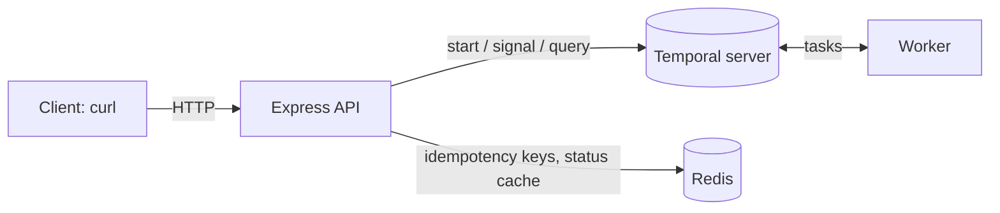

# Session 4 — Express API + Redis

Until now you drove the process with scripts. This session puts an HTTP API in front of it,
so any system can start an invoice process, read its state and send a decision. Redis joins
to absorb repeated requests and repeated reads.

## Architecture of this session



The API and the worker are separate processes. The API never runs workflow code: it only
talks to the Temporal server, exactly like the scripts did.

## Endpoints

| Request | Temporal operation | Success | Errors |
| --- | --- | --- | --- |
| `POST /api/start-process` | start workflow | `202` | `400` bad request, `409` invoice already has a process |
| `GET /api/process/:id` | describe + query `status` | `200` | `404` unknown process |
| `POST /api/process/:id/approve` | signal `approve` | `202` | `400`, `404`, `409` already finished |
| `POST /api/process/:id/reject` | signal `reject` | `202` | `400`, `404`, `409` already finished |
| `GET /health` | none | `200` | |

Why `202 Accepted` and not `200` or `201`: the request was taken, but the work it asks for
has not finished and may take days. The response says where to look: `Location: /api/process/<id>`.

## Concepts

### Two layers against duplicates

| Layer | Protects against | How | Answer |
| --- | --- | --- | --- |
| **Idempotency key** (Redis) | The client sending the *same request* twice: a retry after a timeout, a double click | `Idempotency-Key` header stored with `SET ... NX` for 24 hours | `200` with the original workflow ID and `duplicate: true` |
| **Workflow ID** (Temporal) | A *different request* for an invoice that already has a process | Workflow ID is `invoice-<invoice id>`; Temporal refuses a second one | `409 Conflict` |

The first is a convenience for well-behaved clients. The second is the guarantee, and it
holds even if Redis is down or the client sends no key. This is the same split as an
idempotent consumer in front of a unique constraint in a database.

The reuse policy is `ALLOW_DUPLICATE_FAILED_ONLY`: an invoice whose process **failed** (for
example, a reverted payment) can be submitted again; one that is running or completed cannot.

### What Redis caches, and for how long

Reading a status costs a round trip to Temporal and a workflow replay on a worker. A screen
that polls every second would multiply that by every open browser.

| Workflow is... | Cached for | Why |
| --- | --- | --- |
| Running | 2 seconds | The state can change at any moment; a short cache only absorbs bursts |
| Closed | 1 hour | A closed workflow never changes again |

After a signal the API deletes the cached status, so the next read is fresh. The response
header `X-Cache: HIT` or `MISS` tells you where the answer came from.

### Redis is never the source of truth

Every Redis call in `src/api/store.js` fails open: if Redis is unreachable the API logs a
warning and continues without the shortcut. You will prove this in step 7.

### Where validation lives

The API checks only the shape of the request, enough to build the workflow ID. Business rules
(amount, currency) stay in the workflow. That way an invalid invoice leaves a record you can
inspect, instead of vanishing as a `400`.

## Steps

All commands run inside the dev container unless noted.

### 0. Install the new dependency

```bash
npm install
```

### 1. Start the worker and the API

```bash
npm run worker       # terminal 1
npm run api          # terminal 2: "API listening on http://localhost:3000"
```

Check it: `curl http://localhost:3000/health`

### 2. Start a process

```bash
curl -i -X POST http://localhost:3000/api/start-process \
  -H "Content-Type: application/json" \
  -H "Idempotency-Key: demo-1" \
  -d '{"invoice":{"id":"INV-1001","supplier":"Acme Supplies","amount":1500.5,"currency":"MXN"},"options":{"approvalTimeoutSeconds":300}}'
```

Expected: `HTTP/1.1 202 Accepted`, a `Location` header, and
`{"workflowId":"invoice-INV-1001","duplicate":false}`. The workflow appears in the Web UI.

### 3. Repeat the same request

Run the exact command from step 2 again.

Expected: `200 OK` and `"duplicate":true`. The Web UI still shows one workflow.

### 4. Same invoice, different request

Run it once more, changing only the header to `Idempotency-Key: demo-2`.

Expected: `409 Conflict`. Redis did not recognise the key, so Temporal's workflow ID stopped it.

### 5. Read the status twice

```bash
curl -i http://localhost:3000/api/process/invoice-INV-1001
curl -i http://localhost:3000/api/process/invoice-INV-1001
```

Run them within two seconds of each other. Expected: the first has `X-Cache: MISS`, the
second `X-Cache: HIT`. Both show `"execution":"RUNNING"` and `"status":"AWAITING_APPROVAL"`.

### 6. Approve, then try to reject

```bash
curl -i -X POST http://localhost:3000/api/process/invoice-INV-1001/approve \
  -H "Content-Type: application/json" \
  -d '{"approver":"ana.manager","comment":"Looks good"}'

curl -i http://localhost:3000/api/process/invoice-INV-1001

curl -i -X POST http://localhost:3000/api/process/invoice-INV-1001/reject \
  -H "Content-Type: application/json" \
  -d '{"approver":"bob.director","reason":"Too late"}'
```

Expected: `202` for the approval; then `"execution":"COMPLETED"` and `"status":"PAID"`;
then `409` for the rejection, because the process has already finished.

If the status right after approving still shows `PAYING` or `NOTIFYING`, that is the workflow
doing its work. Wait two seconds and ask again.

### 7. Experiment: take Redis away

In **Windows PowerShell**, from the repository folder (the dev container has no Docker):

```powershell
docker compose exec redis redis-cli KEYS "*"      # see the idem:* and status:* keys
docker compose stop redis
```

Back in the container, start and read a new invoice (`INV-1002`). Everything still works:
the API terminal prints warnings, every read is `X-Cache: MISS`, and repeating a request
with the same idempotency key now returns `409` instead of `200`, because only the Temporal
layer is left. Then bring Redis back:

```powershell
docker compose start redis
```

### 8. Error cases

```bash
curl -i http://localhost:3000/api/process/invoice-DOES-NOT-EXIST          # 404
curl -i -X POST http://localhost:3000/api/start-process \
  -H "Content-Type: application/json" -d '{"invoice":{"supplier":"No id"}}'   # 400
curl -i -X POST http://localhost:3000/api/start-process \
  -H "Content-Type: application/json" \
  -d '{"invoice":{"id":"INV-1003","supplier":"Acme","amount":-5,"currency":"MXN"}}'   # 202!
curl -i http://localhost:3000/api/process/invoice-INV-1003                # execution: FAILED
```

The negative amount is accepted with `202` and then fails inside the workflow. Because the
workflow failed, the reuse policy lets you submit `INV-1003` again with a corrected amount.

## Check yourself

- A client gets a network timeout on `POST /api/start-process` and does not know whether it
  worked. What should it do, and why is that safe?
- Why is the status of a running workflow cached for 2 seconds and not 60?
- Redis loses all its data. What breaks?
- Why does the API open one Temporal connection at startup instead of one per request?
- Why do `approve` and `reject` answer `202` and not `200`?

## Done when

- [ ] The whole flow (start, read, approve) works with `curl` alone.
- [ ] Repeating a request with the same `Idempotency-Key` returns `200` and creates nothing.
- [ ] The same invoice with a different key returns `409`.
- [ ] You saw `X-Cache: MISS` followed by `X-Cache: HIT`.
- [ ] With Redis stopped, the API kept working.
- [ ] Commit created: `Session 4: HTTP API with Redis idempotency and status cache`

## Troubleshooting

| Symptom | Cause and fix |
| --- | --- |
| `Cannot find module 'ioredis'` | Run `npm install` inside the container |
| `API failed to start: ... 7233` | Temporal is not reachable. Check `echo $TEMPORAL_ADDRESS` (should be `temporal:7233`) |
| `GET /api/process/:id` takes about 10 seconds and returns `503` | No worker is running: a query needs one. Start `npm run worker` |
| `curl: (7) Failed to connect to localhost port 3000` | The API is not running, or it crashed. Look at terminal 2 |
| `409` when you expected `202` | That invoice ID was already used. Pick a new `id` |
| `Redis error: ...` lines in the API terminal | Redis is stopped or restarting. The API keeps working without it |
