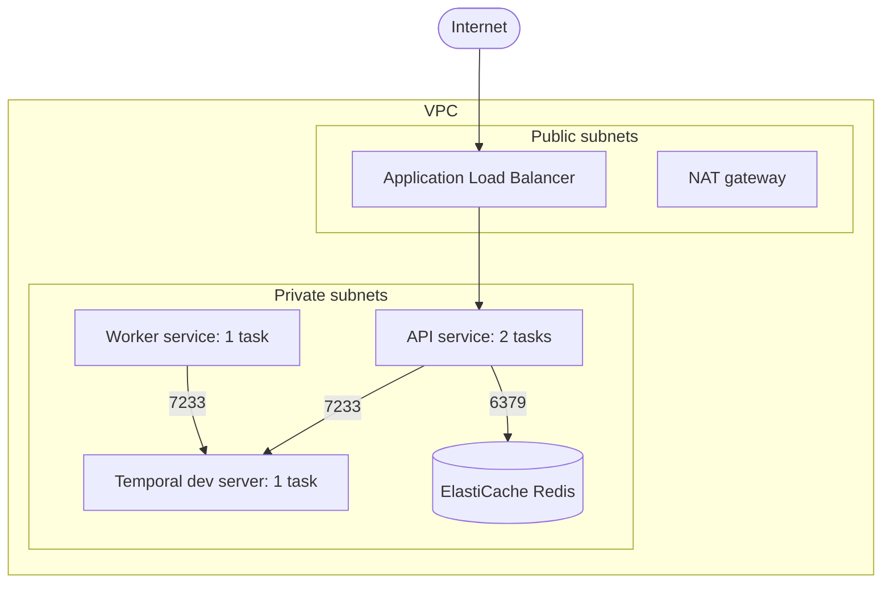

# Session 6 — AWS CDK: infrastructure as code

The application is finished and tested. This session describes where it will run: a network,
a container cluster, a load balancer and a Redis instance on AWS, all written as code.

**Nothing is deployed in this session and nothing is billed.** You need no AWS account yet.
Everything here happens on your machine: CDK turns code into a CloudFormation template, and
you read and test that template. Deployment is session 8.

## What gets described



Only the load balancer is reachable from the internet. Everything else has no public address.

### About the Temporal server

Temporal runs here as the same single-binary development server you use locally, as one ECS
task. **This is a demo setup**: all workflow state is in memory and is lost if the task
restarts. It was chosen so that one `cdk deploy` brings up the whole system inside your own
AWS account. A production system would use Temporal Cloud, or a self-hosted Temporal cluster
backed by a database; in both cases only `TEMPORAL_ADDRESS` (plus credentials) would change
in this stack.

## Concepts

| CDK concept | What it is | Closest thing you know |
| --- | --- | --- |
| **App** | The program. Running it produces templates | A Bicep project |
| **Stack** | A unit of deployment: one CloudFormation stack | A Bicep deployment / resource group |
| **Construct** | A reusable building block; constructs contain constructs | A Bicep module |
| **Synth** | Running the app to generate CloudFormation JSON | `bicep build` producing an ARM template |
| **CloudFormation** | The AWS service that creates the resources from the template | Azure Resource Manager |

The key idea: **your CDK code never calls AWS**. It builds a tree of objects and prints a
template. That is why `cdk synth` and the tests need no credentials.

### Three levels of construct

All three appear in `infra/lib/business-auto-stack.js`:

| Level | Example in the stack | What you write | What you get |
| --- | --- | --- | --- |
| **L1** `Cfn*` | `elasticache.CfnCacheCluster` | Every property, exactly as CloudFormation names it | One resource |
| **L2** | `ec2.Vpc`, `ecs.Cluster`, `ecs.FargateService` | Intent, with defaults | A resource plus what it needs (roles, routes) |
| **L3** pattern | `ecsPatterns.ApplicationLoadBalancedFargateService` | A use case | Load balancer, listener, target group, service, security groups, roles |

The stack is about 200 lines and produces 59 resources. Step 3 shows you where they come from.

### Security groups that reference each other

```js
temporalService.connections.allowFrom(api.service, ec2.Port.tcp(7233), 'API to Temporal');
```

This does not say "allow these IP addresses". It says "allow whatever is in the API's
security group". Tasks come and go with new addresses and the rule stays correct. The Azure
equivalent is an NSG rule that uses Application Security Groups as source.

### One image, two roles

`Dockerfile` builds one image. The API and the worker are the same image started with
different commands (`node src/api/server.js` and `node src/worker.js`). One build, one thing
to scan and version, and no chance of the API and the worker running different code.

## Steps

All commands run inside the dev container, from the repository root.

### 0. Install the CDK project's dependencies

```bash
npm install                  # root: picks up the new scripts
npm --prefix infra install   # the CDK app has its own package.json
```

`infra/` is a separate Node project on purpose: `aws-cdk-lib` is large and has nothing to do
with what runs in the container.

### 1. Read the stack

Open `infra/lib/business-auto-stack.js` and read it top to bottom. It is ordered the way you
would explain the system: network, cluster, Temporal, Redis, image, API, worker, who may
talk to whom, creation order, outputs.

### 2. Synthesize

```bash
npm run cdk:synth
```

It prints the CloudFormation template as YAML and writes it to `infra/cdk.out/`. A message
about feature flags not being configured is informational; ignore it.

### 3. See how much the constructs wrote for you

```bash
node -e "
const t = require('./infra/cdk.out/BusinessAutoStack.template.json');
const count = {};
for (const r of Object.values(t.Resources)) count[r.Type] = (count[r.Type] || 0) + 1;
console.log(Object.keys(t.Resources).length, 'resources');
console.table(count);
"
```

Find in the output: the single line `new ec2.Vpc(...)` became about 20 resources (subnets,
route tables, routes, gateways). The seven IAM roles were never mentioned in the code.

Then open `infra/cdk.out/BusinessAutoStack.template.json` and search for `7233`. You will
find the two ingress rules, each with a `SourceSecurityGroupId` instead of an IP range.

### 4. Run the infrastructure tests

```bash
npm run cdk:test
```

Expected: 19 passed. Open `infra/test/business-auto-stack.test.js`: the tests state the
decisions that matter in plain sentences, for example "the load balancer is the only thing
open to the internet" and "Redis accepts connections on 6379 from exactly one source".

### 5. Break a rule and watch a test catch it

In `infra/lib/business-auto-stack.js`, add this line next to the other `allowFrom` calls:

```js
redisSecurityGroup.connections.allowFrom(workerService, ec2.Port.tcp(REDIS_PORT), 'oops');
```

Run `npm run cdk:test`. The test about Redis having exactly one source fails. Remove the line.

Then change `publicLoadBalancer: true` to `false`, run the tests, see which one fails, and
change it back.

### 6. Change something and see the difference in the template

Change the API's `desiredCount` from `2` to `3`, then:

```bash
npm run cdk:synth > /tmp/after.yaml
git stash
npm run cdk:synth > /tmp/before.yaml
git stash pop
diff /tmp/before.yaml /tmp/after.yaml
```

One number changed in one resource. That is the whole review a teammate would need to do.
(Once the stack is deployed, `cdk diff` does this against what is really running.) Put the
value back to `2`.

### 7. Build the production image (Windows PowerShell)

The dev container has no Docker, so run this in PowerShell from the repository folder:

```powershell
docker build -t business-auto .
docker run --rm business-auto node -e "console.log('image ok, node', process.version)"
docker images business-auto
```

The build should finish without errors and the image should run. Session 8 lets CDK do this
build and push it for you.

## What this would cost

Nothing until it is deployed. Once deployed, these are billed by the hour whether or not
anyone uses them: the load balancer, the NAT gateway, the Redis node and the four Fargate
tasks. The plan for session 8 is to deploy, verify and destroy within the hour. Check current
prices in the AWS Pricing Calculator for your region before deploying.

## Check yourself

- `cdk synth` works with no AWS credentials. Why?
- Which resources in the template did you not write a line of code for? Why does CDK add them?
- The worker has no load balancer and no open port. How does work reach it?
- Why do the API and the worker declare a dependency on the Temporal service, and why only
  between the service resources?
- What would have to change in this stack to use Temporal Cloud instead?

## Done when

- [ ] `npm run cdk:synth` produces the template without errors.
- [ ] `npm run cdk:test` passes: 19 tests.
- [ ] You broke a security rule and a test caught it.
- [ ] The production image builds and runs on your machine.
- [ ] Commit created: `Session 6: AWS infrastructure with CDK`

## Troubleshooting

| Symptom | Cause and fix |
| --- | --- |
| `cdk: not found` or `Cannot find module 'aws-cdk-lib'` | Run `npm --prefix infra install` |
| Synth is slow the first time | CDK fingerprints the repository files for the image. `.dockerignore` keeps that small |
| `82 feature flags are not configured` | Informational. Safe to ignore |
| `docker build` fails at `npm ci` | `package-lock.json` is out of date. Run `npm install` in the dev container and build again |
| Root `npm test` starts running infrastructure tests | It should not: check `modulePathIgnorePatterns` in the root `package.json` |
