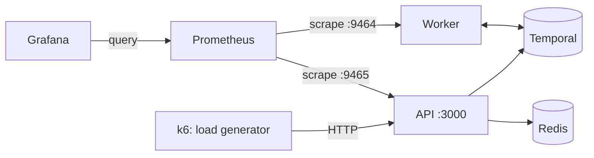

# Session 7 — Observability and load testing

The system works and is tested. This session answers two different questions: **how do you
see what it is doing**, and **how much can it take**.

## What gets added



| Tool | Role | Azure equivalent |
| --- | --- | --- |
| **Prometheus** | Collects and stores metrics as time series. It *pulls*: every 5 s it reads `/metrics` from each process | Azure Monitor metrics |
| **Grafana** | Draws dashboards from Prometheus | Azure Monitor workbooks / dashboards |
| **k6** | Generates load and reports what the clients experienced | Azure Load Testing |

Remember the difference from session 1: the **Temporal Web UI** shows one execution, event by
event. **Grafana** shows aggregates: rates and percentiles across thousands of executions.

## Concepts

### Rate, errors, duration

For a request-driven service, three numbers describe its health from the outside:

| | Question | Metric |
| --- | --- | --- |
| **Rate** | How many requests per second? | `http_request_duration_seconds_count` |
| **Errors** | What share failed? | the same, filtered by `status_code=~"5.."` |
| **Duration** | How long did they take? | `http_request_duration_seconds_bucket` (p50, p95, p99) |

### Why percentiles and not the average

If 99 requests take 10 ms and one takes 5 s, the average is 60 ms and looks fine. p99 is 5 s
and tells the truth about the slowest 1%. A client that makes 100 calls will almost always
hit that slow one.

### Two latencies that must not be confused

| | What it measures | Typical value here |
| --- | --- | --- |
| **API latency** | Time to *accept* a request: start a workflow, send a signal | Milliseconds |
| **Process duration** | Time for the whole business process to finish | Seconds to days, mostly waiting for a person |

The load test measures the first. The second is a business metric, not a performance one.

### Saturation

The point where adding load no longer adds throughput: latency climbs, queues grow, errors
appear. Each layer has its own signal, and the dashboard shows all three:

| Layer | Signal | Panel |
| --- | --- | --- |
| API process | The event loop falls behind | API: event loop lag |
| Worker | No free execution slots | Worker: free task slots |
| Task queue | Tasks wait before a worker takes them | Worker: time tasks wait in the queue |

### Open versus closed load model

The k6 script in the original brief used 1000 virtual users in a loop with a one-second pause.
That is a *closed* model: when the system slows down, the users slow down with it, the request
rate drops, and the test hides the overload it was meant to find. This script uses *arrival
rate* executors (an *open* model): requests start at the chosen rate no matter how the system
is doing. When k6 cannot keep the rate it reports **dropped iterations**.

### Metrics on a separate port

The API serves metrics on port 9465 and the worker on 9464, not under the API's port 3000. On
AWS the load balancer forwards only port 3000, so the metrics are never exposed publicly.

## Steps

Commands marked **container** run in the dev container; **host** means Windows PowerShell in
the repository folder.

### 0. Install the new dependency — container

```bash
npm install
```

### 1. Start Prometheus and Grafana — host

```powershell
docker compose up -d prometheus grafana
```

A warning about an orphan container named `app` is the dev container; ignore it.

### 2. Restart the worker and the API — container

```bash
npm run worker       # terminal 1
npm run api          # terminal 2
```

Both now print a metrics address. Look at the raw data:

```bash
curl -s localhost:9465/metrics | grep http_request
curl -s localhost:9464/metrics | grep -o '^temporal_[a-z_]*' | sort -u
```

The first is empty until the API receives a request. The second lists the metric names the
Temporal SDK exports.

### 3. Check the plumbing — browser

- http://localhost:9090/targets — both `api` and `worker` must be **UP**.
- http://localhost:3001 — Dashboards → **Business Auto**.

### 4. Smoke test — host

```powershell
docker compose --profile loadtest run --rm k6 run /scripts/k6.js
```

Five processes per second for 30 seconds. Watch the dashboard while it runs. In the k6
summary, read:

- `checks`: must be 100%.
- `http_req_duration`: `med`, `p(95)`, `p(99)`.
- `http_req_failed`: must be 0%.
- `iterations`: about 150, each one a complete workflow. Confirm in the Temporal Web UI.

### 5. Ramp: find the saturation point — host

```powershell
docker compose --profile loadtest run --rm -e SCENARIO=ramp k6 run /scripts/k6.js
```

Two and a half minutes, climbing from 10 to 400 iterations per second in five steps. Keep the
dashboard open. For each step, note in `docs/load-test-results.md`:

- The p99 on the latency panel. At which step does it cross 200 ms?
- Which saturation signal moves first: event loop lag, free worker slots, or queue wait?
- Whether k6 reports `dropped_iterations`.

k6 will end by saying thresholds were crossed. That is the expected result of this scenario:
the thresholds are the brief's targets, and the point is to find where they stop holding.

### 6. Tuning experiment: what is the Redis cache worth? — both

Run the read scenario with the cache on (the default):

```powershell
docker compose --profile loadtest run --rm -e SCENARIO=reads k6 run /scripts/k6.js
```

Note the latency percentiles and `status_cache_hits`. Then, in the container, stop the API
and start it with the cache disabled:

```bash
STATUS_CACHE=off npm run api
```

Run the same k6 command again and compare. With the cache off every read is a Temporal query,
which a worker answers by replaying the workflow. Look at the worker panels too: the reads
now load the *worker*, which the cache had been protecting.

Restart the API normally (`npm run api`) when done.

### 7. Optional: worker concurrency — both

```bash
WORKER_MAX_ACTIVITIES=5 npm run worker
```

Run the smoke or ramp scenario and watch **free task slots** hit zero and **queue wait** grow,
while the API latency stays healthy. The API accepts work faster than the worker finishes it:
the backlog sits safely in Temporal. Restart the worker normally afterwards.

### 8. Write down what you measured

Complete `docs/load-test-results.md`. The numbers that go in the final README are these, not
the targets from the brief.

## Reading the results honestly

- Everything runs on one machine: k6, the API, the worker, Temporal and Redis compete for the
  same CPU. The saturation point you find is the laptop's, not the architecture's.
- The Temporal server here is the development build with an in-memory store.
- The activities are simulated and return immediately. Real ones would call slow systems, and
  worker capacity would matter much more.
- What transfers to AWS is the *method* and the *shape*: which signal saturates first, and
  how much the cache helps.

## Cleaning up after load tests

The ramp creates thousands of workflows in the dev server's memory. If Temporal becomes slow:

```powershell
docker compose restart temporal
```

Then restart the worker and the API.

## Check yourself

- p50 is 8 ms and p99 is 900 ms. What does that tell you that an average of 30 ms would not?
- During the ramp, API latency is fine but queue wait keeps growing. What is happening, and
  is anything being lost?
- Why does a closed-model test (fixed virtual users) understate the problem under overload?
- Why would labelling the latency metric with the full URL be a mistake?
- The cache-off run loaded the worker. Why does a *read* need a worker at all?

## Done when

- [ ] Both Prometheus targets are UP and the dashboard shows data during a test.
- [ ] You ran `smoke` with 100% checks.
- [ ] You ran `ramp` and identified the step where p99 crosses 200 ms.
- [ ] You compared `reads` with the cache on and off.
- [ ] `docs/load-test-results.md` has your numbers.
- [ ] Commit created: `Session 7: metrics, dashboard and load tests`

## Troubleshooting

| Symptom | Cause and fix |
| --- | --- |
| A Prometheus target is DOWN | That process is not running, or was started before this session's code. Restart `npm run worker` / `npm run api` |
| Dashboard panels say "No data" | No traffic yet, or the time range is too wide. Run the smoke test and set the range to the last 5 minutes |
| Worker panels stay empty while API panels work | The SDK metric names may differ from the ones in the dashboard. List them with the `grep` in step 2 and edit the panel query |
| k6: `connection refused` to `app:3000` | The API is not running in the dev container |
| k6: `setup: could not start ...: 409` | Leftovers cannot collide (IDs include a run ID); check that the API is healthy with `curl localhost:3000/health` |
| k6: `Insufficient VUs` warnings | The system is slower than the arrival rate. That is saturation: note the step |
| `EADDRINUSE :::9464` or `:::9465` | An earlier worker or API is still running in another terminal |
| Mounts fail when starting Prometheus or Grafana | Run the `docker compose` command from the repository root, where `observability/` is |
